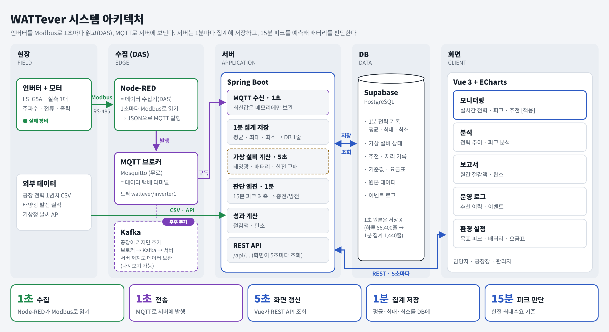

# WATTever — Smart Factory Energy Solution

공장에 **한전 전기 + 태양광 + ESS(배터리)** 를 함께 공급한다고 가정하고, ESS의 **충전 / 방전 / 대기**를 추천해 전기요금을 줄이는 **하이브리드 공장 전력관리 시스템** 팀 프로젝트입니다.

- **가장 중요한 목적은 15분 최대수요전력(피크) 방어**입니다. 비싼 요금 시간대의 ESS 활용은 차순위 옵션입니다.
- 한전 100% / 태양광 자가소비 / 태양광+ESS 추천 운영, 3가지 방식의 전기요금을 비교해 절감 추정액을 보여줍니다.
- 태양광과 ESS는 가상 설비이며, 데이터는 대부분 시뮬레이션입니다.

| 화면 | 내용 |
|---|---|
| 실시간 관제 | 실시간 지표, 15분 피크 게이지, ESS 추천, 공장 레이아웃 / 전력 흐름 |
| 운영 이력 | 추천 → 적용 여부 → 결과 로그 |
| 성적표 | 피크 방어 실적, 운영 방식별 전기요금 비교, 탄소 절감 추정 |
| 설정 | 목표 피크, 요금 시간대·단가, ESS 사양, 운영 모드 |

기획 내용은 [회의 내용 정리](WATTever_회의내용정리.md)를 참고하세요.

## 기술 스택

| 구분 | 기술 |
|---|---|
| Frontend | Vue 3 (JavaScript), Vite, Pinia, Vue Router, ECharts |
| Backend | Spring Boot 4.1, Java 17, Gradle, Spring Data JPA |
| Database | PostgreSQL (Supabase, 팀 공용) |
| API 문서 | Swagger (springdoc-openapi) |

## 아키텍처



자세한 결정 사항과 데이터 흐름은 [결정 사항](docs/decisions.md)을 참고하세요.

## 빠른 시작

> 처음이라면 [개발 환경 세팅 가이드](docs/1-getting-started.md)부터 읽어주세요.

```bash
# 1. DB 접속 정보 넣기 (처음 한 번)
#    backend/.env.example 을 복사해서 backend/.env 로 만들고 값 채우기

# 2. 백엔드 실행 → http://localhost:8080
cd backend
./gradlew bootRun

# 3. 프론트엔드 실행 (새 터미널) → http://localhost:5173
cd frontend
npm install
npm run dev
```

- Swagger (API 문서): http://localhost:8080/swagger-ui.html

## 폴더 구조

```
.
├── backend/              # Spring Boot 서버
├── frontend/             # Vue 웹 화면
└── docs/                 # 팀 가이드 문서
```

## 가이드 문서

1. [개발 환경 세팅](docs/1-getting-started.md) - 설치, 실행, 자주 나는 오류
2. [백엔드 가이드](docs/2-backend-guide.md) - API 하나 만드는 전체 흐름
3. [프론트엔드 가이드](docs/3-frontend-guide.md) - 화면에서 API 호출하고 상태 관리하기
4. [협업 가이드](docs/4-collaboration-guide.md) - Git 브랜치, 커밋, PR 규칙

팀 결정 사항(확정/미정)은 [결정 사항](docs/decisions.md)에 정리되어 있습니다.
