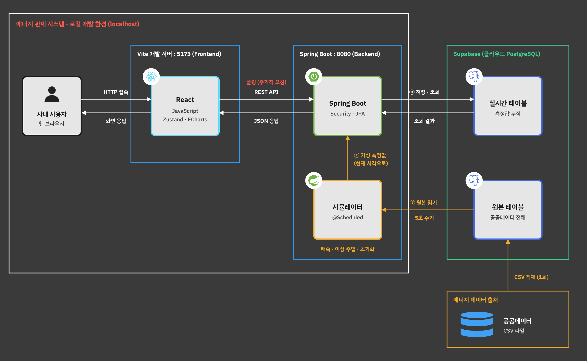

# Smart Factory Energy Solution

스마트 팩토리 설비의 에너지 사용량을 모니터링하는 **에너지 관제 시스템** 팀 프로젝트입니다.

## 기술 스택

| 구분 | 기술 |
|---|---|
| Frontend | React 19 (JavaScript), Vite, Zustand, React Router, ECharts |
| Backend | Spring Boot 4.1, Java 17, Gradle, Spring Data JPA |
| Database | PostgreSQL (Supabase, 팀 공용) |
| API 문서 | Swagger (springdoc-openapi) |

## 아키텍처



자세한 결정 사항과 데이터 흐름은 [결정 사항](docs/decisions.md)을 참고하세요.

## 빠른 시작

> 처음이라면 [개발 환경 세팅 가이드](docs/1-getting-started.md)부터 읽어주세요.

```bash
# 1. DB 접속 정보 넣기 (처음 한 번)
#    backend/.env.example 을 복사해서 backend/.env 로 만들고 값 채우기

# 2. 백엔드 실행 → http://localhost:8080
cd backend
./gradlew bootRun

# 3. 프론트엔드 실행 (새 터미널) → http://localhost:5173
cd frontend
npm install
npm run dev
```

- Swagger (API 문서): http://localhost:8080/swagger-ui.html

## 폴더 구조

```
.
├── backend/              # Spring Boot 서버
├── frontend/             # React 웹 화면
└── docs/                 # 팀 가이드 문서
```

## 가이드 문서

1. [개발 환경 세팅](docs/1-getting-started.md) - 설치, 실행, 자주 나는 오류
2. [백엔드 가이드](docs/2-backend-guide.md) - API 하나 만드는 전체 흐름
3. [프론트엔드 가이드](docs/3-frontend-guide.md) - 화면에서 API 호출하고 상태 관리하기
4. [협업 가이드](docs/4-collaboration-guide.md) - Git 브랜치, 커밋, PR 규칙

팀 결정 사항(확정/미정)은 [결정 사항](docs/decisions.md)에 정리되어 있습니다.
