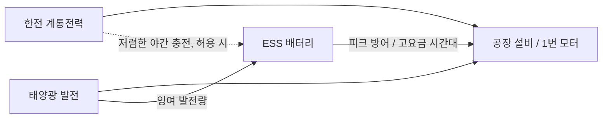
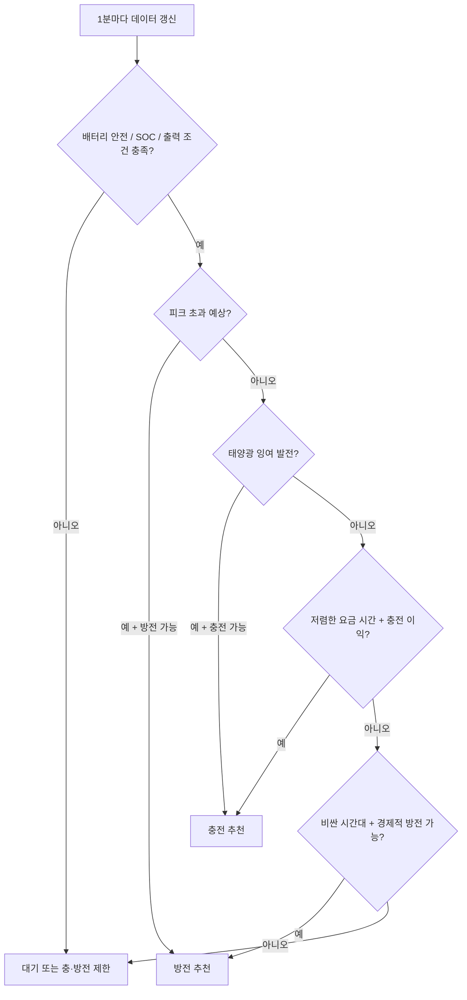

# WATTever — 하이브리드 공장 전력관리 시스템

> **용도:** AI 개발·설계 전달용 핵심 요구사항  
> **상태:** 기획 검토 중. 확정되지 않은 부분은 `확인 필요`로 표시.  
> **화면 기준:** 사용자가 제공한 WATTever 메인 화면 시안

## 1. 프로젝트 목적

공장 설비에 **한전 계통전력 + 태양광 발전전력**을 함께 공급하고, 필요하면 **ESS(배터리)**를 이용해 전기요금을 줄이는 모니터링·운영 추천 시스템이다. 가장 중요한 목적은 **15분 최대수요전력(피크) 방어**이며, 추가로 **비싼 요금 시간대의 ESS 활용**을 검토한다.

- 기존 **한전 100%** 사용과 **태양광 자가소비**, **태양광+ESS 추천 운영**을 비교해 절감액을 보여준다.
- 공장 설비(시연에서는 1번 모터)의 현재 사용전력, 전력 공급원, ESS 상태를 실시간으로 시각화한다.
- ESG 관점의 에너지·배터리 관리 및 탄소배출 절감 추정치도 제공한다. 단, 핵심 성과지표는 **전기요금 절감**이다.
- 실제 장비 연결이 제한되어 **가상 데이터 기반으로 구현**, 가능하면 실제 모터/PLC·인버터 데이터를 일부 결합해 시연한다.

## 2. 전력 공급 구조

- **태양광:** 발전 중인 전력을 가능한 한 공장에서 **직접 자가소비**하고, 남는 전력은 조건에 따라 ESS에 충전한다. 태양광 전력이 반드시 ESS를 통과하는 구조는 아니다.
- **한전:** 태양광과 ESS로 감당하지 못하는 전력을 공급한다. 한전 구매전력량 및 비용은 **후청구** 개념으로 표시한다.
- **ESS:** 피크 발생을 막기 위해 필요한 순간 방전하거나, 잉여 태양광·저렴한 야간 전력으로 충전한다. **충전 / 방전 / 대기** 중 하나만 선택한다(동시 충·방전 금지 가정).
- ESS를 거칠 때 충·방전 손실과 수명·유지비가 발생하므로 **항상 충전하거나 방전하는 것이 최적은 아니다**. 실제 손실률은 설비 스펙 확인 필요.
- 자가소비형과 온사이트형 태양광 조달 방식은 구분한다. **태양광/한전 공급 비율을 고정(예: 10:90)한다는 가정은 확정하지 않는다.**

## 3. 핵심 판단 조건 7가지

| 구분 | 요소 | 판단 목적 |
|---|---|---|
| 한전·요금 | ① 시간대별 전기요금 | 비싼 시간대인지 확인 |
| 한전·피크 | ② 15분 피크 위험 | 이 시간대에 피크 초과가 예상되는지 확인 |
| 태양광·ESS | ③ 배터리 잔량(SOC) | 충전·방전 가능 잔량 확인 |
| 태양광·ESS | ④ 태양광 발전량 | 현재 설비 소비전력 대비 충분한지, 잉여가 있는지 확인 |
| 태양광·ESS | ⑤ 날씨 | 태양광 발전 가능 상황 및 향후 발전량 참고 |
| 태양광·ESS | ⑥ 배터리 최대 충·방전 출력 | 필요한 순간 공급할 수 있는 전력 상한 확인 |
| 태양광·ESS | ⑦ 배터리실 환경(온도) | 안전한 운영 가능 여부 확인(습도는 추후 검토) |

**① 시간대 + ② 피크 위험은 하나의 요금·피크 판단 그룹으로 묶어** 추천에 활용한다. 안전·출력·SOC 조건을 먼저 검사한 뒤 비용 및 피크를 검토하는 **룰베이스 함수**로 구현한다.

## 4. 핵심 계산 및 추천 로직

### 계산 1 — 15분 피크 실시간 예측

- **1분마다** 전력 사용량을 읽고 현재 **15분 수요전력 구간**의 예상 평균전력(kW)을 계산한다.
- 사용자가 설정한 **목표 피크(kW)**를 넘을 것으로 예상되면 경고하고 ESS 방전을 추천한다.
- 예측 예시: `예상 15분 평균전력(kW) = (경과시간 동안 측정한 전력(kW)의 합×1분 + 남은 시간(분)×향후 예상전력(kW)) / 15분` (1분 간격 데이터 기준).
- 화면에 현재 구간 시간, 남은 시간, 예상 피크, 목표 피크, 초과 예상 여부 및 방어 필요 전력을 보여준다.
- **실제 한전 요금의 기본요금 산정은 계약종별 규정 확인 필요.** 단순히 ‘이번 달 최고 15분값 = 전체 전기요금’으로 처리하면 안 된다.

### 계산 2 — ESS 상태 추천

- 추천 결과는 **충전 / 방전 / 대기**, 추천 이유, 판단에 사용한 값, 적용 여부를 남긴다.
- 피크 방어를 **최우선**, 비싼 요금 시간대 활용을 **차순위 옵션**으로 둔다.
- 배터리는 **소규모 피크 방어 중심**으로 접근할 수 있으며, 피크 방어와 요금 시간대 대체를 모두 제시하되 경제성이 낮으면 후자는 제외 가능하다.
- 기본은 **운영자 승인 모드**. 야간 운영을 고려한 **자동 모드 버튼**도 제공하지만, 실제 장비가 없다면 **시뮬레이션 작동으로만 표시**한다.
- 온도만으로 화재 안전을 보장할 수 없으므로 실제 운영에서는 BMS 경보·보호계전·설비 인터록 등 추가 안전 조건 확인이 필요하다.

### 계산 3 — 비용 및 탄소 절감 비교

동일한 설비 부하를 가정하여 ① **한전 100%**, ② **태양광 자가소비(ESS 없음)**, ③ **태양광+ESS 룰베이스 운영**의 비용을 비교한다.

- 비교 항목: 구매전력(kWh), 전력량요금, 피크 관련 요금, 총 전기료, 절감액·절감률.
- 태양광 발전량과 소비량의 **시간차**를 반영한다. ESS 충·방전 손실, 운영비·투자비는 별도 표시해 경제성 과장을 피한다.
- 탄소배출 절감량은 **한전 구매전력 감소량 × 적용 배출계수** 등을 기준으로 *참고 추정치*로 제공한다(계수 확인 필요).
- 프로젝트 로그를 통해 **추천 → 운영자 적용 여부 → 실제/시뮬레이션 결과 → 절감 효과**를 추적할 수 있어야 한다.

## 5. 화면 요구사항

### A. 실시간 관제(메인 화면) — 첨부 시안 기준

1. **헤더:** 왼쪽 `WATTever`, 메뉴 `실시간 관제 | 운영 이력 | 성적표 | 설정`, 현재 시각, 날씨.
2. **상단 실시간 지표:** `공장 소비전력`, `태양광 발전량`, `배터리 잔량(SOC)`, `한전 구매전력`. 설비별 실시간 소비전력도 보여준다.
3. **15분 피크 게이지:** 현재 구간(예: 14:00~14:15), 남은 시간, 목표 피크, 예상 피크, 경고 상태. **시안의 예시값:** 공장 2,570kW / 태양광 420kW / ESS 60% / 한전 2,150kW, 예상 피크 2,133kW / 목표 1,800kW / 방전 추천 500kW·10분. 실제 측정값이 아닌 UI 예시로 취급한다.
4. **추천 영역:** 충전·방전·대기 추천, 이유(피크/요금/발전량/배터리 상태), 운영자 적용 버튼 및 가상 자동모드.
5. **전력 시각화:** 기본 화면에는 **공장/설비 레이아웃**, 별도 버튼을 누르면 **한전·태양광·ESS → 공장으로 흐르는 전력원/전력 흐름**을 확인하도록 한다.
6. **전력 비중:** 설비별로 한전/태양광/ESS 공급 비율을 **색상+텍스트+막대** 등으로 직관적으로 표시. 색상은 추후 선정.
7. **실시간성:** 값 갱신, 흐름 애니메이션, 타임스탬프 등으로 화면이 계속 작동 중임을 보여준다. 오늘 전력 그래프(소비/발전/한전/잔량 등)와 배터리실 온도·날씨도 제공한다.

### B. 운영 이력(로그)

시간순 표 중심. **측정 시각, 설비 부하, 태양광/한전/ESS 공급 상태, 15분 피크 예측, 7조건의 주요 값, 추천, 이유, 승인자, 적용 여부, 결과**를 기록한다. 실시간 상태 변화와 과거 이력 검색이 가능해야 한다.

### C. 성적표

기간별 **피크 방어 실적**, 3가지 운영 방식의 **전기요금 비교/절감액**, 구매전력·탄소 절감 추정치, ESS 충·방전 이력 및 효율을 표·차트로 표시한다.

### D. 설정

**목표 피크, 요금 시간대/단가, ESS 용량·SOC 제한·최대출력·효율, 온도 제한, 운영 모드, 데이터 갱신주기** 등 설정값을 관리한다.

## 6. 데이터 및 시연

- **데이터:** 현재는 PLC 수집이 어려우므로 태양광·ESS·한전·설비 전력·날씨 값을 **가상으로 생성**한다. 가능하면 실제 PLC 또는 인버터(모터) 신호를 일부 받아 화면과 연결한다.
- **데모 흐름:** ① 모터 1번 가동 → ② 실시간 설비전력 및 공급원 비율 표시 → ③ 가상 부하/요금/발전량 변경 → ④ 피크 위험 및 충전·방전·대기 추천 변경 → ⑤ 운영자 적용/가상 자동모드 → ⑥ 로그와 성적표에서 결과 확인.
- 실제 모터에 부하를 걸어도 소비전력 증가가 미미할 수 있으므로, **피크 상승은 시뮬레이션 데이터로 재현**한다. 실제 측정값·시뮬레이션값·계산값을 UI와 DB에서 구분한다.
- **데이터 흐름(초안):** `PLC/인버터(가능 시) + 가상 데이터 + 기상/요금 설정 → 데이터 수집 → 1분 계산 엔진 → 추천 엔진 → DB(측정·추천·적용·결과 로그) → 실시간 관제/운영 이력/성적표`. DB에서 읽어오는 방식과 실시간 통신 구조는 재검토한다.

## 7. 경제성·도메인 검토 사항

- ESS는 초기투자비, 교체·유지보수비, 화재 안전 대응, 충·방전 손실이 존재한다. **ESS를 쓰면 무조건 이익이라는 표현은 피한다.**
- 공장은 24시간 가동될 수 있으므로 발전량과 소비량의 시간차를 해소하는 ESS의 장점이 있지만, **배터리 용량을 작게 설계해 피크 방어 중심**으로 검토한다.
- 지붕임대, ESS 임대 등 초기비용을 줄이는 방식도 검토한다. 배터리 기대수명(메모상 10~15년), 투자 회수 여부와 국내 ESS 지원정책 현황은 **검증 필요**.
- 자가소비형/온사이트형의 계약·배전 구조, 계통 충전 허용 여부, 실제 한전 요금제, 배터리 안전기준은 도메인 확인이 필요하다.

## 8. 컨펌 필요한 결정

- [ ] **주요 목적:** 피크 방어 **우선** + 고요금 시간 ESS 활용 **옵션**으로 확정할지
- [ ] **비교 기준:** 3가지(한전 100% / 태양광만 / 태양광+ESS)로 확정할지
- [ ] **피크 목표:** 사용자 입력값, 15분 구간 계산/예측 방식, 요금제 기준
- [ ] **전력 공급:** 실제 태양광 직결/ESS 연결 방식, 공급원 비율 계산 방식
- [ ] **ESS 조건:** 용량, 충·방전 출력, SOC 상·하한, 손실률, 온도 제한, 동시 충·방전 불가 가정
- [ ] **운영 방식:** 추천+운영자 승인, 자동모드는 시뮬레이션으로 표시
- [ ] **시연 범위:** 실제 모터/PLC에서 받는 값과 가상으로 대체할 값
- [ ] **화면/DB:** 공장 레이아웃과 전력 흐름 전환 UI, 로그 필드, 실시간 갱신 및 저장 방식

**개발 우선순위:** ① 실시간 관제/전력 흐름 → ② 15분 피크 계산 → ③ 7조건 룰베이스 추천 → ④ 로그 → ⑤ 전기료·탄소 성적표 → ⑥ 설정·시연 완성.
