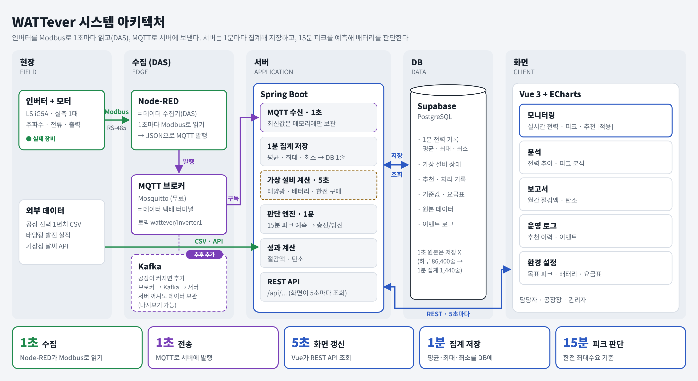

# 결정 사항

팀에서 정한 내용을 기록합니다. 새로 정해지면 아래에 추가해주세요.

## 확정

| 항목 | 결정 | 비고 |
|---|---|---|
| 실행 환경 | **로컬 실행 (localhost)** | 프론트 :5173, 백엔드 :8080, DB는 Supabase |
| 프론트엔드 | Vue 3 (JavaScript, `<script setup>`), Vite, Pinia, Vue Router, ECharts | 강사님 안내로 React에서 Vue로 변경. TypeScript, Docker 사용 안 함 |
| 서버 데이터 관리 | Pinia + `client.js` (fetch) | |
| 화면 실시간 갱신 | **폴링** (주기적으로 API 재요청) | |
| 백엔드 | Spring Boot 4.1, Java 17, Gradle, Spring Data JPA | API 문서는 Swagger |
| DB | **Supabase (PostgreSQL) 팀 공용 DB 1개** | 접속 정보는 `backend/.env` (Git 제외). Supabase는 DB로만 사용 (Supabase 로그인/자동 API 사용 안 함) |
| 로그인 | **없음** (2026-11-16 결정으로 뺌) | 처리자는 "운영자" / "자동 모드" 글자로만 기록 |

## 기획 (WATTever)

기획 원문은 [회의 내용 정리](../WATTever_회의내용정리.md)에 있습니다.

### 확정

| 항목 | 결정 | 비고 |
|---|---|---|
| 프로젝트 이름 | **WATTever** (하이브리드 공장 전력관리 시스템) | 한전 + 태양광 + ESS |
| 주요 목적 | **15분 피크 방어 우선**, 고요금 시간대 ESS 활용은 옵션 | 핵심 성과지표는 전기요금 절감 |
| 비교 기준 | **3가지**: 한전 100% / 태양광 자가소비(ESS 없음) / 태양광+ESS 추천 운영 | 성적표 화면 |
| 운영 방식 | **추천 + 운영자 승인** | 자동 모드는 실제 제어가 아니므로 "시뮬레이션"으로 표시 |
| 화면 | 모니터링 / 분석 / 보고서 / 운영 로그 / 환경 설정 | 로그인 화면 없음 |
| 프론트 UI | UI 라이브러리 없이 직접 작성 | Element Plus 등 설치 안 함 |
| 계산 위치 | 피크 예측, 추천, 절감액, 탄소는 **백엔드가 계산**, 프론트는 표시만 | |

### 확인 필요

- [ ] 피크 목표: 사용자 입력값, 15분 구간 계산/예측 방식, 요금제 기준
- [ ] 전력 공급: 태양광 직결/ESS 연결 방식, 설비별 공급원 비율 계산 방식
- [ ] ESS 조건: 용량, 충·방전 출력, SOC 상·하한, 손실률, 온도 제한
- [ ] 시연 범위: 실제 모터/PLC에서 받는 값과 가상으로 대체할 값
- [ ] API 주소와 필드, 로그 필드, 실측/시뮬레이션/계산값 구분 방법
- [x] 계산 주기: 시뮬레이터 1초 측정 → 1분 집계 저장 → 15분 피크 판단, 화면 폴링 5초
- [ ] 추천의 유효 시간과 만료 처리
- [ ] 공급원(한전/태양광/ESS) 색상, 공장 레이아웃 구현 방식
- [ ] 탄소 배출계수

## 에너지 데이터 흐름

| 단계 | 내용 |
|---|---|
| 데이터 출처 | **공공데이터 CSV 파일** |
| ① 적재 (1회) | CSV를 Supabase **원본 테이블**에 한 번 넣음 |
| ② 시뮬레이터 | 백엔드의 `@Scheduled` 작업이 **1초마다** 원본 테이블을 읽어, **현재 시각**의 가상 측정값으로 바꿈 |
| ③ 저장 | **1분마다** 평균·최대·최소를 **실시간 테이블**(site_power_minute, power_minute, ess_status_minute)에 저장. 화면은 실시간 테이블을 조회 |
| 실측 장비 | 인버터(LS iG5A) → Modbus RS-485 → Node-RED(DAS)가 1초마다 읽어 DB에 바로 저장. **MQTT는 쓰지 않음** (2026-11-18 결정) |
| 시뮬레이터 기능 | 배속, 이상 주입, 초기화 |

- **시뮬레이터는 팀에서 1명만 실행합니다.** 팀 공용 DB라서 여러 명이 동시에 실행하면 실시간 테이블에 데이터가 중복으로 쌓입니다.
  - 담당자만 `backend/.env`에 `SIMULATOR_ENABLED=true`를 넣고, 나머지는 `false`(기본값)로 둡니다.
  - `@Scheduled` 작업은 이 값이 `true`인 PC에서만 실행됩니다.
- **초기화는 모든 팀원의 데이터에 영향을 줍니다.** 실행 전에 팀에 공유해주세요.
- CSV를 넣기 전에 컬럼 이름을 **영어 소문자와 `_`** 로 바꿔주세요. (예: `measured_at`, `power_kwh`) 한글 컬럼 이름은 JPA Entity와 연결하기 어렵습니다.
