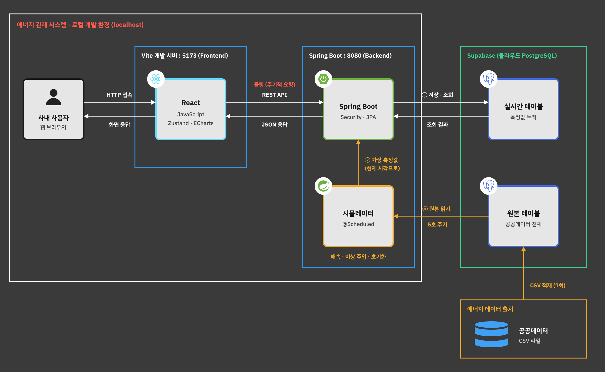

# 결정 사항

팀에서 정한 내용을 기록합니다. 새로 정해지면 아래에 추가해주세요.

## 확정

| 항목 | 결정 | 비고 |
|---|---|---|
| 실행 환경 | **로컬 실행 (localhost)** | 프론트 :5173, 백엔드 :8080, DB는 Supabase |
| 프론트엔드 | Vue 3 (JavaScript, `<script setup>`), Vite, Pinia, Vue Router, ECharts | 강사님 안내로 React에서 Vue로 변경. TypeScript, Docker 사용 안 함 |
| 서버 데이터 관리 | Pinia + `client.js` (fetch) | |
| 화면 실시간 갱신 | **폴링** (주기적으로 API 재요청) | |
| 백엔드 | Spring Boot 4.1, Java 17, Gradle, Spring Data JPA | API 문서는 Swagger |
| DB | **Supabase (PostgreSQL) 팀 공용 DB 1개** | 접속 정보는 `backend/.env` (Git 제외). Supabase는 DB로만 사용 (Supabase 로그인/자동 API 사용 안 함) |
| 로그인 | **회원가입 없이 로그인만** 제공 | 사내 시스템. 계정은 관리자가 미리 만들어 둠 |
| 인증 방식 | **Spring Security + 세션(쿠키) 방식** | 로그인하지 않으면 API 401. 아직 미구현 |

## 에너지 데이터 흐름

| 단계 | 내용 |
|---|---|
| 데이터 출처 | **공공데이터 CSV 파일** |
| ① 적재 (1회) | CSV를 Supabase **원본 테이블**에 한 번 넣음 |
| ② 시뮬레이터 | 백엔드의 `@Scheduled` 작업이 **5초마다** 원본 테이블을 읽어, **현재 시각**의 가상 측정값으로 바꿈 |
| ③ 저장 | 가상 측정값을 **실시간 테이블**에 누적 저장. 화면은 실시간 테이블을 조회 |
| 시뮬레이터 기능 | 배속, 이상 주입, 초기화 |

- **시뮬레이터는 팀에서 1명만 실행합니다.** 팀 공용 DB라서 여러 명이 동시에 실행하면 실시간 테이블에 데이터가 중복으로 쌓입니다.
  - 담당자만 `backend/.env`에 `SIMULATOR_ENABLED=true`를 넣고, 나머지는 `false`(기본값)로 둡니다.
  - `@Scheduled` 작업은 이 값이 `true`인 PC에서만 실행됩니다.
- **초기화는 모든 팀원의 데이터에 영향을 줍니다.** 실행 전에 팀에 공유해주세요.
- CSV를 넣기 전에 컬럼 이름을 **영어 소문자와 `_`** 로 바꿔주세요. (예: `measured_at`, `power_kwh`) 한글 컬럼 이름은 JPA Entity와 연결하기 어렵습니다.
