# WATTever 데이터베이스 ERD

> Supabase (PostgreSQL) · 테이블 11개 + 뷰 1개
> 1분 단위 시계열 수집 → 15분 수요 구간 집계 → ESS 운전 추천

## 1. ERD

```mermaid
erDiagram
    zone ||--o{ equipment : "구역에 속함"
    equipment ||--o{ power_minute : "1분 전력 기록"
    setting ||--o{ setting_history : "변경 이력"
    recommendation |o--o{ event_log : "관련 이벤트"
    site_power_minute ||..o{ demand_interval_15m : "15분 집계 (VIEW)"

    zone {
        BIGSERIAL zone_id PK
        VARCHAR name UK "구역명"
        INT display_order "표시 순서"
    }

    equipment {
        VARCHAR equipment_id PK
        BIGINT zone_id FK "GRID/SOLAR/ESS는 NULL"
        VARCHAR name "설비명"
        VARCHAR equipment_role "GRID·SOLAR·ESS·LOAD"
        NUMERIC rated_kw "정격 kW"
        BOOLEAN is_virtual "가상 설비 여부"
        INT modbus_slave_id "Modbus 슬레이브 ID"
        VARCHAR mqtt_topic "MQTT 토픽"
        BOOLEAN is_active "사용 여부"
        TIMESTAMPTZ created_at "등록 시각"
    }

    power_minute {
        VARCHAR equipment_id PK, FK
        TIMESTAMPTZ ts PK "측정 시각"
        NUMERIC avg_kw "평균 kW"
        NUMERIC max_kw "최대 kW"
        NUMERIC min_kw "최소 kW"
        NUMERIC energy_kwh "사용 전력량"
        NUMERIC grid_kwh "한전 몫"
        NUMERIC solar_kwh "태양광 몫"
        NUMERIC ess_kwh "ESS 몫"
    }

    site_power_minute {
        TIMESTAMPTZ ts PK "측정 시각"
        NUMERIC grid_kw "한전 구매"
        NUMERIC solar_kw "태양광 발전"
        NUMERIC ess_kw "+방전 / -충전"
        NUMERIC load_kw "공장 소비"
    }

    demand_interval_15m {
        TIMESTAMPTZ interval_start "15분 구간 시작"
        NUMERIC actual_avg_kw "실제 평균 (결과 피크)"
        NUMERIC no_ess_avg_kw "방전 없었다면"
        NUMERIC reduced_kw "ESS 저감량"
        BIGINT minute_count "15면 완전한 구간"
    }

    ess_status_minute {
        TIMESTAMPTZ ts PK "측정 시각"
        NUMERIC power_kw "+방전 / -충전"
        NUMERIC charge_kwh "충전량"
        NUMERIC discharge_kwh "방전량"
        NUMERIC soc "잔량 %"
        NUMERIC battery_temp "배터리실 온도"
        VARCHAR status "CHARGE·DISCHARGE·IDLE"
    }

    weather {
        TIMESTAMPTZ ts PK "기준 시각"
        NUMERIC temperature "기온"
        NUMERIC humidity "습도"
        NUMERIC cloud_cover "운량"
        VARCHAR sky "CLEAR·CLOUDY·OVERCAST"
        NUMERIC radiation_wm2 "일사량 W/m2"
        VARCHAR source "ASOS·OPEN_METEO"
    }

    setting {
        VARCHAR setting_key PK
        VARCHAR group_name "PEAK_TARIFF·ESS·OPERATION·SOLAR"
        VARCHAR label "화면 표시명"
        VARCHAR value "설정값"
        VARCHAR unit "단위"
        TIMESTAMPTZ updated_at "수정 시각"
        VARCHAR updated_by "수정자"
    }

    setting_history {
        BIGSERIAL history_id PK
        TIMESTAMPTZ changed_at "변경 시각"
        VARCHAR setting_key FK "설정 키"
        VARCHAR old_value "이전 값"
        VARCHAR new_value "새 값"
        VARCHAR changed_by "변경자"
    }

    tariff_period {
        BIGSERIAL period_id PK
        VARCHAR season "SUMMER·SPRING_FALL·WINTER"
        VARCHAR period_type "OFF_PEAK·MID_PEAK·ON_PEAK"
        TIME start_time "시작 시각"
        TIME end_time "종료 시각"
        NUMERIC unit_price "원/kWh"
    }

    recommendation {
        BIGSERIAL recommendation_id PK
        TIMESTAMPTZ recommended_at "추천 시각"
        TIMESTAMPTZ interval_start "대상 15분 구간"
        VARCHAR action "CHARGE·DISCHARGE·IDLE"
        NUMERIC power_kw "지시 출력 kW"
        VARCHAR reason_type "추천 사유"
        TEXT description "추천 설명"
        NUMERIC predicted_avg_kw "예측 평균 kW"
        NUMERIC target_peak_kw "목표 피크 kW"
        VARCHAR status "PENDING·APPLIED·AUTO·SKIPPED·EXPIRED"
        VARCHAR handled_by "처리자"
        TIMESTAMPTZ handled_at "처리 시각"
    }

    event_log {
        BIGSERIAL event_id PK
        TIMESTAMPTZ occurred_at "발생 시각"
        VARCHAR event_type "이벤트 종류"
        VARCHAR stage "NORMAL·CAUTION·WARNING"
        TEXT message "메시지"
        BIGINT recommendation_id FK "관련 추천"
    }
```

## 2. 테이블 관계

| 부모 테이블 | 자식 테이블 | 연결 컬럼 | 관계 |
|---|---|---|---|
| `zone` | `equipment` | `zone_id` | 1 : N (NULL 허용) |
| `equipment` | `power_minute` | `equipment_id` | 1 : N |
| `setting` | `setting_history` | `setting_key` | 1 : N |
| `recommendation` | `event_log` | `recommendation_id` | 1 : N (NULL 허용) |
| `site_power_minute` | `demand_interval_15m` (VIEW) | `ts` → `interval_start` | 15분 단위 집계 |

## 3. 테이블 정의

### 3.1 설비 · 구역

#### `zone` — 구역
| 키 | 컬럼 | 타입 | 제약 | 설명 |
|---|---|---|---|---|
| PK | zone_id | BIGSERIAL | | |
| | name | VARCHAR(30) | NOT NULL, UNIQUE | 구역명 |
| | display_order | INT | NOT NULL, DEFAULT 0 | 표시 순서 |

#### `equipment` — 설비
| 키 | 컬럼 | 타입 | 제약 | 설명 |
|---|---|---|---|---|
| PK | equipment_id | VARCHAR(30) | | |
| FK | zone_id | BIGINT | → zone | GRID/SOLAR/ESS는 NULL |
| | name | VARCHAR(50) | NOT NULL | 설비명 |
| | equipment_role | VARCHAR(10) | NOT NULL | GRID / SOLAR / ESS / LOAD |
| | rated_kw | NUMERIC(10,2) | | 정격 kW |
| | is_virtual | BOOLEAN | NOT NULL, DEFAULT TRUE | 가상 설비 여부 |
| | modbus_slave_id | INT | | Modbus 슬레이브 ID |
| | mqtt_topic | VARCHAR(100) | | MQTT 토픽 |
| | is_active | BOOLEAN | NOT NULL, DEFAULT TRUE | 사용 여부 |
| | created_at | TIMESTAMPTZ | NOT NULL, DEFAULT now() | 등록 시각 |

#### `power_minute` — 설비별 1분 전력
| 키 | 컬럼 | 타입 | 제약 | 설명 |
|---|---|---|---|---|
| PK, FK | equipment_id | VARCHAR(30) | → equipment | |
| PK | ts | TIMESTAMPTZ | NOT NULL | 측정 시각 |
| | avg_kw | NUMERIC(10,2) | NOT NULL | 평균 kW |
| | max_kw | NUMERIC(10,2) | | 최대 kW |
| | min_kw | NUMERIC(10,2) | | 최소 kW |
| | energy_kwh | NUMERIC(10,4) | | 사용 전력량 |
| | grid_kwh | NUMERIC(10,4) | | 한전 몫 (LOAD 설비만) |
| | solar_kwh | NUMERIC(10,4) | | 태양광 몫 |
| | ess_kwh | NUMERIC(10,4) | | ESS 몫 |

인덱스: `idx_power_minute_ts (ts)`

### 3.2 공장 전력 · ESS · 날씨 (1분 시계열)

#### `site_power_minute` — 공장 전체 1분 전력
| 키 | 컬럼 | 타입 | 제약 | 설명 |
|---|---|---|---|---|
| PK | ts | TIMESTAMPTZ | | 측정 시각 |
| | grid_kw | NUMERIC(10,2) | NOT NULL | 한전 구매 |
| | solar_kw | NUMERIC(10,2) | NOT NULL | 태양광 발전 |
| | ess_kw | NUMERIC(10,2) | NOT NULL | +방전 / −충전 |
| | load_kw | NUMERIC(10,2) | NOT NULL | 공장 소비 |

#### `demand_interval_15m` — 구간 15분 (VIEW)
`site_power_minute`를 15분 단위로 묶어 조회할 때 계산합니다(저장하지 않음).

| 컬럼 | 계산식 | 설명 |
|---|---|---|
| interval_start | `date_bin('15 minutes', ts, ...)` | 15분 구간 시작 |
| actual_avg_kw | `AVG(grid_kw)` | 실제 평균 (결과 피크) |
| no_ess_avg_kw | `AVG(grid_kw + GREATEST(ess_kw, 0))` | 방전 없었다면 |
| reduced_kw | `AVG(GREATEST(ess_kw, 0))` | ESS 저감량 |
| minute_count | `COUNT(*)` | 15면 완전한 구간 |

#### `ess_status_minute` — ESS 1분 상태
| 키 | 컬럼 | 타입 | 제약 | 설명 |
|---|---|---|---|---|
| PK | ts | TIMESTAMPTZ | | 측정 시각 |
| | power_kw | NUMERIC(10,2) | NOT NULL | +방전 / −충전 |
| | charge_kwh | NUMERIC(10,4) | NOT NULL, DEFAULT 0 | 충전량 |
| | discharge_kwh | NUMERIC(10,4) | NOT NULL, DEFAULT 0 | 방전량 |
| | soc | NUMERIC(5,2) | NOT NULL | 잔량 % |
| | battery_temp | NUMERIC(5,2) | | 배터리실 온도 |
| | status | VARCHAR(10) | NOT NULL | CHARGE / DISCHARGE / IDLE |

#### `weather` — 날씨
| 키 | 컬럼 | 타입 | 제약 | 설명 |
|---|---|---|---|---|
| PK | ts | TIMESTAMPTZ | | 기준 시각 |
| | temperature | NUMERIC(5,2) | | 기온 ℃ |
| | humidity | NUMERIC(5,2) | | 습도 % |
| | cloud_cover | NUMERIC(5,2) | | 운량 % |
| | sky | VARCHAR(10) | | CLEAR / CLOUDY / OVERCAST (맑음/구름많음/흐림) |
| | radiation_wm2 | NUMERIC(7,2) | | 일사량 W/m² (직전 구간 평균) |
| | source | VARCHAR(12) | NOT NULL | ASOS / OPEN_METEO |

### 3.3 운영 설정

#### `setting` — 설정
| 키 | 컬럼 | 타입 | 제약 | 설명 |
|---|---|---|---|---|
| PK | setting_key | VARCHAR(40) | | |
| | group_name | VARCHAR(15) | NOT NULL | PEAK_TARIFF / ESS / OPERATION / SOLAR |
| | label | VARCHAR(50) | NOT NULL | 화면 표시명 |
| | value | VARCHAR(50) | NOT NULL | 설정값 |
| | unit | VARCHAR(15) | | 단위 |
| | updated_at | TIMESTAMPTZ | NOT NULL, DEFAULT now() | 수정 시각 |
| | updated_by | VARCHAR(30) | NOT NULL, DEFAULT '운영자' | 마지막 수정자 |

#### `setting_history` — 설정 변경 이력
| 키 | 컬럼 | 타입 | 제약 | 설명 |
|---|---|---|---|---|
| PK | history_id | BIGSERIAL | | |
| | changed_at | TIMESTAMPTZ | NOT NULL, DEFAULT now() | 변경 시각 |
| FK | setting_key | VARCHAR(40) | NOT NULL, → setting | 설정 키 |
| | old_value | VARCHAR(50) | | 이전 값 |
| | new_value | VARCHAR(50) | NOT NULL | 새 값 |
| | changed_by | VARCHAR(30) | NOT NULL, DEFAULT '운영자' | 변경자 |

인덱스: `idx_setting_history_key_time (setting_key, changed_at)`

#### `tariff_period` — 요금 시간대
| 키 | 컬럼 | 타입 | 제약 | 설명 |
|---|---|---|---|---|
| PK | period_id | BIGSERIAL | | |
| | season | VARCHAR(12) | NOT NULL | SUMMER / SPRING_FALL / WINTER |
| | period_type | VARCHAR(10) | NOT NULL | OFF_PEAK / MID_PEAK / ON_PEAK (경부하/중간부하/최대부하) |
| | start_time | TIME | NOT NULL | 시작 시각 |
| | end_time | TIME | NOT NULL | 종료 시각 (24:00 허용) |
| | unit_price | NUMERIC(6,1) | NOT NULL | 원/kWh |

제약: `start_time < end_time`

### 3.4 ESS 추천 · 이벤트

#### `recommendation` — 추천 이력
| 키 | 컬럼 | 타입 | 제약 | 설명 |
|---|---|---|---|---|
| PK | recommendation_id | BIGSERIAL | | |
| | recommended_at | TIMESTAMPTZ | NOT NULL | 추천 시각 |
| | interval_start | TIMESTAMPTZ | NOT NULL | 대상 15분 구간 시작 |
| | action | VARCHAR(10) | NOT NULL | CHARGE / DISCHARGE / IDLE |
| | power_kw | NUMERIC(10,2) | NOT NULL, DEFAULT 0 | 지시 출력 kW |
| | reason_type | VARCHAR(25) | NOT NULL | PEAK_DEFENSE / ON_PEAK_DISCHARGE / SOLAR_SURPLUS_CHARGE / OFF_PEAK_CHARGE / SAFETY_LIMIT / IDLE |
| | description | TEXT | | 추천 설명 |
| | predicted_avg_kw | NUMERIC(10,2) | | 예측 평균 kW |
| | target_peak_kw | NUMERIC(10,2) | | 목표 피크 kW |
| | status | VARCHAR(10) | NOT NULL, DEFAULT 'PENDING' | PENDING / APPLIED / AUTO / SKIPPED / EXPIRED (추천중/적용/자동/넘김/만료) |
| | handled_by | VARCHAR(30) | | 처리자 (자동이면 NULL) |
| | handled_at | TIMESTAMPTZ | | 처리 시각 |

인덱스: `idx_recommendation_time (recommended_at)`, `idx_recommendation_interval (interval_start)`

#### `event_log` — 이벤트 로그
| 키 | 컬럼 | 타입 | 제약 | 설명 |
|---|---|---|---|---|
| PK | event_id | BIGSERIAL | | |
| | occurred_at | TIMESTAMPTZ | NOT NULL | 발생 시각 |
| | event_type | VARCHAR(15) | NOT NULL | STAGE_CHANGE / RECOMMEND / HANDLE / INTERVAL_END / COMM / SETTING |
| | stage | VARCHAR(10) | | NORMAL / CAUTION / WARNING |
| | message | TEXT | NOT NULL | 메시지 |
| FK | recommendation_id | BIGINT | → recommendation | 관련 추천 |

인덱스: `idx_event_log_time (occurred_at)`

## 4. 보안

모든 테이블에 RLS(Row Level Security, 행 단위 접근 제어)를 켜 두어 Supabase REST API를 통한 외부 접근을 막습니다. Spring 서버는 테이블 소유자 계정(`postgres`)으로 접속하므로 영향을 받지 않습니다.
