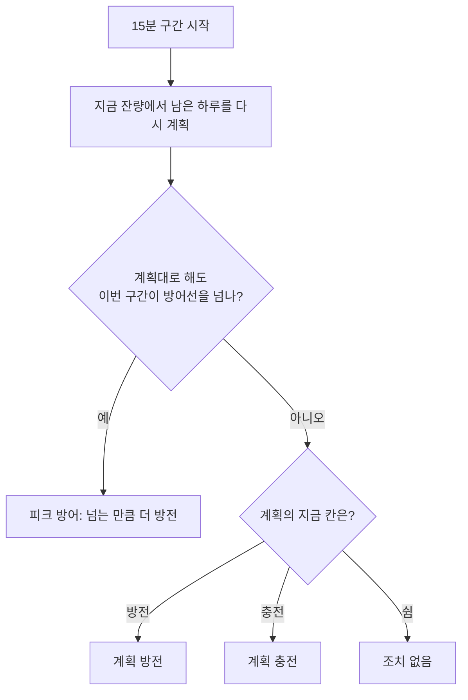

# ESS 추천 로직 설명

WATTever가 ESS(배터리)에 **충전 · 방전 · 대기**를 어떻게 추천하는지 쉽게 정리한 문서입니다.

> 지금 이 로직은 프론트엔드의 가짜 백엔드에 들어 있습니다. 추천 계산은 `frontend/src/api/fakeRecommendation.js`, 데이터와 상태(지금 추천, 적용 중인 출력, 이벤트)는 `frontend/src/api/fakeBackend.js`에 있습니다.
> 화면 확인과 시연을 위한 것이고, 실제 계산은 나중에 백엔드가 맡습니다. 이 문서는 그때 넘길 설계 설명이기도 합니다.
>
> 2026-11-18부터 하루 계획은 실제 데이터 대신 AI가 예측한 공장 부하로 세웁니다(4-7절). 예측 모델은 `ai/forecast/`에 있습니다.

---

## 1. 한눈에 보기

1. **하루를 미리 보고 계획을 세웁니다.** 오늘 남은 시간의 공장 전력과 태양광을 보고, 15분마다 충전·방전·대기를 정합니다.
2. **피크 방어가 1순위, 요금 절감이 2순위입니다.** 먼저 15분 피크가 방어선(목표 피크 1,800 kW)을 넘지 않게 하고, 그 안에서 남는 배터리로 싼 시간에 충전해 비싼 시간에 씁니다.
3. **실시간으로 계획을 바로잡습니다.** 15분 구간마다 다시 계획하고, 계획대로 해도 넘칠 것 같으면 그 구간만 "피크 방어"를 추가로 추천합니다.



---

## 2. 먼저 알아 둘 것: 전기요금이 정해지는 방식

| 요금 | 정해지는 방식 | 영향 기간 |
|---|---|---|
| **기본요금** | 1년 중 **가장 높았던 15분 평균 전력(피크)** × 단가 | **1년 내내** |
| **전력량요금** | 쓴 전기(kWh) × 시간대별 단가 (경부하·중간부하·최대부하) | 그 달만 |

- 피크가 한 번 높게 찍히면 1년 동안 비싼 기본요금을 냅니다. 그래서 **피크 방어가 가장 중요**합니다.
- 참고한 논문(Jang 외, 2022, KAIST·한전 전력연구원)도 같은 결론입니다. ESS로 아낀 돈의 대부분은 기본요금에서 나왔고, 요금 차익만 노린 운영은 절감이 0.1%에 그쳤습니다.

**15분 피크란?** 14:00~14:15처럼 15분마다 끊어서 그동안의 **평균** 전력을 잽니다. 순간적으로 높아도 15분 평균이 낮으면 괜찮습니다.

---

## 3. 어떤 데이터로 계산하나

| 값 | 데이터 | 우리 공장 크기로 바꾸는 식 |
|---|---|---|
| 공장 전력 | 제철소 실측 15분 전력량 (2018년, UCI 공개 데이터) | 공장 kW = 1,300 + 1.35 × (usage_kwh × 4) |
| 공장 전력 예측 (계획용) | AI 예측값 `fakeLoadForecast.json` (평균 예측, 상위 90% 예측) | 위와 같은 식 |
| 태양광 | 경상남도 태양광 시간별 발전량 (2025년, 전력거래소) | 태양광 kW = 발전량(MWh) × 1.536, 밤 21~05시는 0 |
| 날씨 | 그날 태양광 발전량으로 추정 | 그 달 가장 잘 나온 날의 75% 이상 맑음, 40% 이상 흐림, 그 아래 비 |

- 연도가 다르므로 공장 전력은 **같은 달·같은 요일**, 태양광은 **같은 월·일**의 값을 씁니다.
- **ESS가 없을 때 한전에서 사야 하는 전력 = 공장 전력 − 태양광** 입니다. 이 값이 1,800을 넘으면 피크 위험입니다.
- 실제 데이터에서 이 값의 15분 평균이 1,800을 넘는 날은 1년 중 86일이고, 주로 **해 진 뒤(16~20시)와 아침 8시**에 넘습니다.

---

## 4. 하루 계획 (`planDay`)

### 4-1. 무엇을 정하나

하루를 15분 칸 96개로 나누고, 칸마다 배터리를 **얼마나 충전 / 방전 / 쉴지** 정합니다.

### 4-2. 무엇을 가장 작게 만들려고 하나 (비용)

```
비용 = 전력량요금 (한전에서 산 전기 × 그 시각 단가)
     + 배터리 마모 비용 (방전한 kWh × 20원)
```

- 마모 비용이 있는 이유: 배터리는 쓸수록 닳습니다. 아끼는 돈이 닳는 값보다 작으면 쓰지 않는 게 낫습니다.
- 하루 끝에 남은 잔량도 계산에 넣습니다. 시작(50%)보다 모자라면 내일 경부하에 다시 채워야 하니 그만큼 비용으로 셉니다.

### 4-3. 반드시 지킬 것 (제약)

- 모든 칸에서 **한전 구매 ≤ 방어선** (방어선 = 목표 피크 1,800 kW)
- 잔량은 **하한 20% ~ 상한 90%**
- 충·방전은 **최대 출력 500 kW**까지
- 충전할 때는 손실이 있습니다. 효율이 89.5%라서 100 kWh를 사 와도 89.5 kWh만 찹니다.

### 4-4. 두 가지 모드 (논문 방식)

| 모드 | 언제 | 하는 일 |
|---|---|---|
| **피크 모드** | 배터리로 1,800을 하루 종일 지킬 수 없는 날 | 지킬 수 있는 **가장 낮은 선**으로 방어선을 올림 |
| **요금 모드** | 그 밖 (대부분의 날) | 방어선을 지키는 안에서 남는 배터리로 싸게 충전·비싸게 방전 |

**왜 방어선을 올리나?** 못 지킬 1,800을 고집하면 오전에 배터리를 다 쓰고 저녁의 더 큰 피크를 그대로 맞습니다. 차라리 1,850을 하루 종일 지키는 편이 1년 기본요금에 유리합니다. 방어선은 5 kW 단위까지 "반씩 좁히기"로 찾습니다.

### 4-5. 안전 여유

실제 전력은 계획과 조금씩 다릅니다. 그래서 1,800에 딱 맞추지 않고 조금 낮게 계획합니다.

1. 먼저 **54 kW 여유**(주의선 1,746)로 계획해 봅니다.
2. 배터리가 모자라면 **20 kW 여유**로 다시 계획합니다.
3. 그래도 모자라면 **여유 없이** 계획합니다.

1년 중 가장 빠듯한 날(1월 5일)도 20 kW 여유면 실시간에서 한 구간도 넘지 않았습니다.

### 4-6. 어떻게 푸나: 표 채우기 (동적 계획법)

모든 경우를 다 해 보면 경우의 수가 너무 많습니다. 그래서 표를 채우는 방식으로 풉니다.

| | 00:00 | 00:15 | … | 23:45 |
|---|---|---|---|---|
| 잔량 90% | | | | |
| 잔량 89% | | | | |
| … | | | | |
| 잔량 20% | | | | |

1. 가로는 **시각**(15분 칸), 세로는 **잔량**(1% 단위)입니다.
2. **하루 끝에서부터 거꾸로** 채웁니다. 각 칸에는 "이 시각에 이 잔량이면, 남은 하루를 가장 싸게 보내는 비용"을 적습니다.
3. 다 채우면 지금 잔량에서 출발해 **가장 싼 길을 따라가기만** 하면 그게 계획입니다.

내비게이션이 "도착까지 전체 시간이 가장 짧은 길"을 고르는 것과 같은 원리입니다. 1년치(365일)를 계산해도 1초가 안 걸립니다.

---

### 4-7. AI 부하 예측으로 계획하기 (2026-11-18 추가)

실제 운영에서는 0시에 오늘 17시 부하를 알 수 없습니다. 그래서 계획에는 AI가 예측한 공장 부하를 넣고, 결과(한전 구매, 피크)는 실제 데이터로 계산합니다.

| 값 | 어디에 쓰나 |
|---|---|
| 평균 예측 (`planNetKw`) | 요금 계산 (전력량요금) |
| 상위 90% 예측 (`planPeakNetKw`) | 방어선을 지키는지 판단. 평균 예측은 하루 피크를 낮게 보는 경향이 있어서 보수적인 값을 씀 |
| 실제 값 (`netKw`) | 결과 계산, 실시간 보정 |

예측이 빗나가는 것에 대비해 세 가지를 더했습니다.

1. 빗나간 만큼 보정: 다시 계획할 때 지난 1시간 동안 예측이 빗나간 평균만큼 남은 칸을 올리거나 내립니다 (`planInputsOf`).
2. 예비 잔량: 남은 칸마다 "예측보다 200 kW 더 나오면 추가로 필요한 방전량"을 더해 예비 잔량으로 잡고, 잔량이 모자라면 비용에 벌점을 더합니다. 그래서 계획이 배터리를 미리 채워 두고, 요금 차익을 위한 방전은 줄입니다. AI 예측의 하루 피크 오차 절댓값 평균은 약 150 kW이고, 1년 시뮬레이션에서 방어선 초과가 0이 되는 가장 작은 값을 50 kW 단위로 찾아 200 kW로 정했습니다.
3. 필요한 만큼만 방전: 피크에 대비해 계획한 방전인데 실제가 예측보다 낮으면 필요한 만큼만 방전합니다. 실제가 목표 피크를 넘으면 계획이 방어선을 올린 날에도 목표 피크를 먼저 지키려고 더 방전합니다 (`correctedEssKw`).

하루 시뮬레이션(`simulateDay`)은 실시간 화면과 같은 순서로 움직입니다. 하루 시작, 매시 정각, 실시간 보정이 일어난 직후에 남은 하루를 다시 계획합니다. 매 칸 다시 계획하면 하루 계산이 약 70 ms로 느려져서 이렇게 줄였습니다(하루 평균 약 25 ms).

## 5. 실시간 추천 (`updateDecision`)

화면은 5초마다 서버에서 새 값을 받습니다. 시뮬레이션은 10배속이라 서버 시각으로는 50초마다입니다. 그때마다 아래를 합니다.

### 5-1. 15분 구간마다 다시 계획

구간이 바뀔 때마다 **지금 잔량에서 남은 하루를 다시 계획**합니다. 실제가 계획과 어긋나 잔량이 달라져도 다음 구간에 바로잡습니다. 길을 잘못 들면 내비가 경로를 다시 찾는 것과 같습니다.

### 5-2. 이번 구간의 예상 평균

```
예상 평균 = 구간 시작부터 지금까지 쌓인 값 + 남은 시간 동안 "최근 4분 평균"이 계속된다고 친 값
```

- 순간값 대신 **최근 4분 평균**을 씁니다. 브레이징로가 약 4분 주기로 ±330 kW씩 출렁여서, 순간값을 쓰면 예상이 몇 초 사이에 수백 kW씩 바뀌기 때문입니다.

### 5-3. 피크 방어: 필요한 만큼만 방전

계획대로 해도 예상 평균이 방어선을 넘으면, 넘는 만큼만 더 방전합니다.

```
더 방전할 양(kW) = (예상 평균 − (방어선 − 여유)) × 15 ÷ 남은 분
```

| 예 | 계산 | 추천 |
|---|---|---|
| 예상 1,830, 여유 54, 10분 남음 | (1,830 − 1,746) × 15 ÷ 10 | 126 kW |
| 예상 1,830, 여유 54, 3분 남음 | (1,830 − 1,746) × 15 ÷ 3 | 420 kW |

- 왜 × 15 ÷ 남은 분일까요? 15분 평균을 X kW 낮추려면 15분 동안 X kW만큼의 전력량을 빼야 합니다. 그걸 남은 시간 안에 빼야 하니 남은 시간이 짧을수록 출력이 커집니다.
- 최대 출력(500 kW)과 잔량(하한 20%까지)을 넘지 않게 자릅니다.

### 5-4. 추천 종류

| 추천 | 규칙 번호 | 언제 | 유지 기간 |
|---|---|---|---|
| **피크 방어** | 2 | 계획대로 해도 이번 구간이 방어선을 넘을 것 같을 때 | 그 15분 구간 끝까지 |
| **안전 제한** | 1 | 피크 방어가 필요한데 잔량이 하한이라 못 할 때 | 그 15분 구간 끝까지 |
| **계획 방전** | 5 | 계획의 지금 칸이 방전일 때 (비싼 시간대, 피크 대비) | 계획에서 방전이 이어지는 동안 |
| **계획 충전** | 4 | 계획의 지금 칸이 충전일 때 (싼 시간대, 점심 빈틈) | 계획에서 충전이 이어지는 동안 |
| **조치 없음** | 6 | 그 밖 | 계획에서 쉬는 동안 |

추천 카드에는 이유 문장과 판단 근거(예상 평균, 방어선, 계획 출력, 추가 방전, 잔량, 요금 시간대 등)가 함께 나옵니다.

### 5-5. 다시 묻지 않는 규칙 (운영자 승인 모드)

운영자가 버튼을 너무 자주 누르지 않게, 아래 경우에는 새 추천을 만들지 않고 지금 추천을 유지합니다.

- 같은 종류의 추천이 이어질 때 (예: 계획 방전이 19:15~20:00 계속)
- 피크 방어가 아직 그 15분 구간 안일 때 (방전 → 대기 → 방전 깜빡임 방지)
  - 단, 백엔드 추천 엔진(`RecommendationEngine`)은 같은 구간이라도 아래 두 경우에는 유지를 풀고 다시 추천합니다. 가짜 백엔드(`fakeRecommendation.js`)에는 아직 이 두 예외가 없습니다.
  - **나빠졌을 때**: 방전이 지금 추천보다 **50 kW 이상 더** 필요해지면 (예: 40 kW를 적용해 뒀는데 갑자기 500 kW가 필요해짐) (2026-11-20)
  - **좋아졌을 때**: 남은 시간에 ESS를 전혀 안 써도 이번 구간 예상 평균이 방어선보다 **주의선 차이(목표 − 주의선, 기본 54 kW)만큼 더 낮으면** (예: 태양광이 늘거나 부하가 줄어 예상 피크가 정상으로 돌아옴). 방어선 바로 아래에서 풀면 값이 경계에서 오르내릴 때 방전 ↔ 대기가 매분 바뀌므로 여유를 둡니다. 방전 덕분에 한전 구매가 내려가 있을 뿐, 방전을 멈추면 다시 방어선 근처로 오를 상황이면 풀리지 않습니다. (2026-11-21, 이슈 #33)
- 계획 충·방전 중간에 **1시간 미만**으로 잠깐 쉬는 칸일 때 (그동안 출력은 0)

평범한 날은 하루에 버튼을 **5~9번** 누르면 됩니다. 1년 중 가장 빠듯한 날은 피크 방어가 자주 끼어들어 41번입니다.

### 5-6. 적용 / 넘기기 / 자동 모드

| 선택 | 그 뒤 |
|---|---|
| **적용** | 그 추천이 끝날 때까지 출력을 계획과 필요한 양에 맞춰 자동으로 조절 |
| **넘기기** | 그 추천이 끝날 때까지 쉼 (다시 묻지 않음) |
| **자동 모드** | 추천이 나오면 바로 적용한 것으로 처리. 실제 설비 제어가 아니라 시뮬레이션 |

### 5-7. 배터리 보호

- 잔량이 **하한(20%)**에 닿으면 방전을 멈추고 이벤트 로그에 남깁니다.
- 잔량이 **상한(90%)**에 닿으면 충전을 멈춥니다.
- 충전 때문에 한전 구매가 방어선 쪽으로 올라가면 충전을 줄입니다.

---

## 6. 결과

### AI 부하 예측으로 계획한 1년 시뮬레이션 (2026-11-18)

`simulateDay`를 2026년 1년 동안 돌린 결과입니다. 배터리 1,000 kWh / 500 kW, 요금은 2026.4.16 개편 산업용(을) 고압A 선택Ⅱ입니다.

| 항목 | 태양광만 (ESS 없음) | 태양광 + ESS (AI 예측 + 최적화) |
|---|---|---|
| 1,800 kW를 넘은 15분 구간 | (1년 중 86일 넘음) | 0개 |
| 1년 최고 피크 | 2,027 kW | 1,800 kW |
| 기본요금 | 2억 241만 | 1억 7,971만 |
| 전력량요금 | 16억 5,472만 | 16억 4,270만 |
| 배터리 마모 비용 | - | 494만 |

- ESS가 더해 주는 몫은 연 약 2,980만 원(기본요금 2,270만 + 전력량요금 1,202만 − 마모 494만)입니다.
- 기본요금은 "1년 최고 피크 × 8,320원 × 12개월"로 단순화했습니다. 실제 한전 규정은 직전 12개월 중 여름·겨울(7·8·9·12·1·2월) 피크만 기억합니다(래칫). 이 차이는 한계로 둡니다.
- 부가세, 전력산업기반기금, 설치비는 넣지 않은 "요금 절감 추정"입니다.

아래의 결과들은 예측 반영 전(그날의 실제 데이터를 미리 안다고 보고 계획)에 2021년 일반용 요금표로 계산한 값입니다.

### 하루 실시간 시뮬레이션 (자동 모드, 0~24시)

| 날 | 방어선 넘긴 구간 | 하루 최고 |
|---|---|---|
| 1월 5일 (1년 중 가장 빠듯한 날) | 0 | 1,794 kW |
| 11월 9일 | 0 | 1,770 kW |
| 11월 17일 | 0 | 1,741 kW |
| 7월 15일 | 0 | 1,734 kW |

같은 1월 5일을 예전 방식(목표를 넘을 때만 넘는 만큼 방전, 충전 추천 없음)으로 돌리면 **12구간을 넘기고 최고 2,002 kW**까지 올라갑니다.

### 1년 시뮬레이션 (2026년, 배터리 1,000 kWh / 500 kW)

| | 태양광만 (ESS 없음) | 예전 방식 (경부하 충전 포함) | 하루 계획 |
|---|---|---|---|
| 1년 최고 피크 | 2,027 kW | 1,800 kW | 1,780 kW |
| 전력량요금 | — | 기준 | 연 728만 원 절감 |
| 배터리 마모 비용 | — | 기준 | 연 297만 원 더 듦 |

- 하루 계획의 순이익은 **연 약 430만 원**이고, 대부분 요금 차익에서 나옵니다.
- 이 배터리 크기로는 실제 데이터의 피크를 거의 다 막을 수 있습니다. 그래서 하루 계획의 장점은 요금 절감과 실시간 안정성(여유)에서 주로 나옵니다.
- 배터리를 작게 잡으면(예: 500 kWh / 250 kW) 못 막는 날이 생기고, 그때 피크 모드(방어선 올리기)가 의미를 가집니다.

---

## 7. 1년 예상 전기요금 (운영 방식 4가지)

같은 1년(2026년, 실제 공장·태양광 데이터)을 네 가지 방식으로 돌려 요금을 비교했습니다.

| 운영 방식 | 설명 |
|---|---|
| 1) 한전 100% | 공장 전력을 전부 한전에서 삼 |
| 2) 태양광만 | 태양광으로 덜고 나머지를 한전에서 삼 (ESS 없음) |
| 3) 예전 방식 | 태양광 + ESS. 목표를 넘을 때만 넘는 만큼 방전, 경부하에 충전 |
| 4) 하루 계획 | 태양광 + ESS. 하루를 미리 보고 세운 계획 (이 문서의 방식) |

### 결과

| 운영 방식 | 1년 최고 피크 | 1,800 넘은 날 | 기본요금 | 전력량요금 | **1년 합계** | 한전 100% 대비 |
|---|---|---|---|---|---|---|
| 1) 한전 100% | 2,110 kW | 182일 | 2억 1,068만 | 9억 5,420만 | **11억 6,489만** | — |
| 2) 태양광만 | 2,027 kW | 86일 | 2억 241만 | 8억 4,238만 | **10억 4,479만** | −1억 2,010만 |
| 3) 예전 방식 | 1,800 kW | 0일 | 1억 7,971만 | 8억 4,225만 | **10억 2,196만** | −1억 4,293만 |
| 4) 하루 계획 | 1,780 kW | 0일 | 1억 7,768만 | 8억 3,496만 | **10억 1,265만** | **−1억 5,224만** |

배터리 마모 비용(방전 1 kWh당 20원)은 요금과 따로 셉니다. 예전 방식은 연 11만 원, 하루 계획은 연 308만 원입니다.

### ESS가 더해 주는 몫 (태양광만 대비)

| | 기본요금 절감 | 전력량요금 절감 | 마모비 | **순 절감** |
|---|---|---|---|---|
| 3) 예전 방식 | 2,270만 | 13만 | −11만 | **연 약 2,270만** |
| 4) 하루 계획 | 2,473만 | 742만 | −308만 | **연 약 2,910만** |

### 월별 전력량요금 (만 원, 괄호는 그 달 최고 피크 kW)

| 월 | 1) 한전 100% | 2) 태양광만 | 3) 예전 방식 | 4) 하루 계획 |
|---|---|---|---|---|
| 1월 | 9,584 (2,103) | 8,771 (2,027) | 8,761 (1,800) | 8,696 (1,780) |
| 2월 | 8,251 (2,000) | 7,257 (1,937) | 7,256 (1,800) | 7,185 (1,746) |
| 3월 | 6,458 (2,070) | 5,717 (2,000) | 5,717 (1,800) | 5,717 (1,746) |
| 4월 | 6,262 (1,989) | 5,425 (1,903) | 5,425 (1,800) | 5,425 (1,745) |
| 5월 | 6,383 (1,991) | 5,613 (1,897) | 5,613 (1,800) | 5,613 (1,744) |
| 6월 | 9,233 (1,964) | 7,863 (1,907) | 7,862 (1,800) | 7,722 (1,742) |
| 7월 | 9,610 (1,929) | 8,149 (1,860) | 8,148 (1,800) | 8,002 (1,744) |
| 8월 | 9,566 (1,990) | 8,212 (1,859) | 8,212 (1,800) | 8,066 (1,746) |
| 9월 | 6,087 (1,964) | 5,506 (1,927) | 5,506 (1,800) | 5,505 (1,746) |
| 10월 | 6,489 (2,014) | 5,953 (1,899) | 5,953 (1,800) | 5,952 (1,746) |
| 11월 | 8,760 (2,110) | 7,846 (1,899) | 7,845 (1,800) | 7,767 (1,745) |
| 12월 | 8,736 (2,049) | 7,926 (1,944) | 7,926 (1,800) | 7,845 (1,744) |

### 읽는 법

1. **ESS 효과의 대부분은 기본요금에서 나옵니다.** 피크를 2,027에서 1,800 아래로 낮추면 약 230 kW × 8,320원 × 12개월이 줄어듭니다. 논문 결론과 같습니다.
2. **하루 계획이 더 아끼는 이유는 두 가지입니다.**
   - 여름·겨울에 싸게 충전하고 비싸게 써서 전력량요금을 연 742만 원 줄입니다.
   - 피크를 1,746~1,780으로 여유 있게 지켜 기본요금이 조금 더 줄어듭니다.
3. **봄·가을(3~5월, 9~10월)은 요금 차익을 하지 않습니다.** 경부하 52원에 사면 손실과 마모비를 더해 52 ÷ 0.895 + 20 ≈ 78원이 되는데, 이게 최대부하 71원보다 비쌉니다. 그래서 피크만 막고 쉽니다. 이 달들은 3)과 4)의 전력량요금이 같습니다.
4. **태양광만으로도 연 1억 2천만 원이 줄어듭니다.** 한전에서 사는 전기가 1년에 1,268만 kWh에서 1,141만 kWh로 10% 줄어서입니다.

### 계산 방식과 주의할 점

- **전력량요금** = 15분마다 (한전 구매 kW × 0.25시간 × 그 시각 단가)를 1년 동안 더한 값.
- **기본요금** = 1년 최고 15분 피크 × 8,320원 × 12개월. 논문과 같은 단순화로, 해마다 같은 패턴이 반복된다고 봤습니다. 실제 한전 규정은 특정 달과 계약전력 하한을 따지므로 확인이 필요합니다.
- **하루 끝 잔량 보정:** 시뮬레이션은 매일 0시에 잔량 50%로 시작합니다. 그래서 하루 끝 잔량이 50%보다 많거나 적은 만큼은 경부하 단가로 다시 채우는 값으로 바로잡았습니다. 3)과 4)에 똑같이 적용했습니다.
- **단가가 임시값입니다.** 2021년 일반용 요금표(논문)를 반올림했습니다. 현재 산업용 단가는 더 높아서 실제 금액은 더 큽니다.
- **넣지 않은 것:** 부가세, 전력산업기반기금, 태양광·ESS 설치비와 유지비. 그래서 이 표는 **"요금 절감 추정"**이지 "이익"이 아닙니다.
- **두 ESS 방식 모두 미래를 안다고 가정했습니다.** 실제로는 예측 오차가 있어 절감액이 조금 줄어듭니다.

---

## 8. 파라미터

| 이름 | 값 | 어디서 | 상태 |
|---|---|---|---|
| 목표 피크 | 1,800 kW | 환경 설정 | 설정에서 바꿀 수 있음 |
| 주의선 | 목표의 97% (1,746 kW) | 환경 설정 | 안전 여유 54 kW의 기준 |
| 배터리 용량 | 1,000 kWh | 환경 설정 | |
| 최대 충·방전 출력 | 500 kW | 환경 설정 | |
| 잔량 하한 · 상한 | 20% · 90% | 환경 설정 | |
| 충·방전 효율 | 89.5% | 환경 설정 | |
| 전력량요금 단가 | 여름 116.0 / 163.8 / 229.0원, 봄·가을 116.0 / 133.4 / 150.9원, 겨울 123.0 / 164.0 / 204.6원 (경부하 / 중간 / 최대) | 한전 2026.4.16 개편 산업용(을) 고압A 선택Ⅱ | 봄·가을 토·일 11~14시 50% 할인 반영 |
| 기본요금 단가 | 8,320원/kW | 환경 설정 | 확인 필요 |
| 요금 시간대 | 경부하 22~08시. 봄·여름·가을 최대부하 15~21시, 겨울 최대부하 09~12시·16~19시 | 한전 2026.4.16 개편 | 토요일은 최대부하를 중간부하로 계량. 공휴일 규칙은 미반영 |
| 배터리 마모 비용 | 20원/kWh | 코드 상수 `WEAR_COST_WON_PER_KWH` | **확인 필요**: 이 값에 따라 요금 차익 운영이 크게 달라짐 |
| 하루 시작 잔량 | 50% | 코드 상수 `START_SOC_PERCENT` | 시뮬레이션용 |
| 최소 추천 크기 | 10 kW | 코드 상수 `MIN_ADVICE_KW` | 이보다 작은 충·방전은 추천하지 않음 |
| 쉬는 칸 허용 | 1시간 미만 | 코드 상수 `PLAN_GAP_SLOTS` (4칸) | |
| 예측 보정에 쓰는 기간 | 지난 1시간 | 코드 상수 `BIAS_SLOTS` (4칸) | |
| 예비 잔량 기준 | 예측보다 200 kW 더 나오는 경우 | 코드 상수 `RESERVE_EXTRA_KW` | 1년 시뮬레이션에서 방어선 초과가 0이 되는 가장 작은 값 (50 kW 단위) |
| 예비 잔량 벌점 | 모자란 1 kWh당 한 칸에 300원 | 코드 상수 `RESERVE_PENALTY_WON` | 요금 차익보다 크게 잡아 잔량을 우선함 |
| 공장·태양광 환산식 | 1,300 + 1.35 × kW, × 1.536 | 데이터 README 초안 | 백엔드 시뮬레이터와 같은 식 |

마모 비용에 따른 차이 (1년):

| 마모 비용 | 1년 방전량 | 전력량요금 절감 (마모비 빼기 전) |
|---|---|---|
| 0원 | 약 50만 kWh | 973만 원 |
| 20원 (지금) | 약 15만 kWh | 728만 원 |
| 40원 | 약 7.5만 kWh | 435만 원 |

---

## 9. 한계와 확인할 것

- 공장 부하는 AI 예측으로 계획합니다(4-7절). 태양광은 아직 예보(Open-Meteo)를 연결하지 않아서 실제 값을 계획에 씁니다.
- 실시간 화면의 추천(`updateDecision`)은 아직 4-7절의 "필요한 만큼만 방전"을 쓰지 않습니다. 계획 방전은 계획한 양 그대로 추천합니다.
- **"올해 최고 피크"는 아직 쓰지 않습니다.** 원래 방어선은 "목표 피크와 올해 이미 찍힌 최고 피크 중 높은 쪽"이어야 합니다(합의한 A안). 지금은 보고서 숫자가 다른 가짜 데이터라서 방어선을 목표 피크로만 둡니다.
- **기본요금 규정 확인이 필요합니다.** 1년 최고 피크가 기본요금을 정하는 정확한 규정(어느 달을 보는지)은 한전 계약 종별 확인이 필요합니다.
- **하루 단위 계획입니다.** 자정을 넘는 계획은 하지 않습니다. 하루 끝 잔량의 값으로 내일을 대신 고## 10. 코드 위치

추천 계산은 `fakeRecommendation.js`에 따로 모았습니다. 이 파일의 함수는 넘겨받은 값만 보고 답을 내므로(같은 값이면 같은 답), 백엔드로 옮길 때 이 파일만 보면 됩니다. 환경 설정 값(목표 피크, 잔량 하한·상한 등)은 `limits` 묶음으로 넘겨받습니다.

`frontend/src/api/fakeRecommendation.js` (추천 계산)

| 함수 | 하는 일 |
|---|---|
| `planDay` | 하루 계획 (피크 모드·요금 모드, 표 채우기) |
| `ruleDay` | 예전 방식 (비교용) |
| `socChangeOf` | ESS 출력으로 15분 동안 바뀌는 잔량 |
| `planInputsOf` | 계획에 넣을 값 (AI 예측 + 지난 1시간 오차 보정) |
| `correctedEssKw` | 하루 시뮬레이션의 실시간 보정 (더 방전, 필요한 만큼만 방전, 충전 줄이기) |
| `neededDischargeKw` | 피크 방어에 필요한 방전량 |
| `planBlockEndOf` | 계획에서 같은 동작이 끝나는 시각 (추천이 끝나는 시각) |
| `decideAdvice` | 지금 무엇을 추천할지 (피크 방어·안전 제한·계획 충전·계획 방전·조치 없음, 출력 kW) |
| `peakRiskOf` | 오늘 남은 피크 위험 (첫 위험 시각, 예상 피크, 필요한 잔량) |
| `explainDecision` | 추천 카드의 이유 문장과 판단 근거 |

`frontend/src/api/fakeBackend.js` (데이터와 상태)

| 함수 | 하는 일 |
|---|---|
| `baseLoadAt`, `solarKwAt` | 그 시각의 공장 전력·태양광 (실제 데이터) |
| `dayInputs` | 하루 96칸의 ESS 없이의 값 (공장, 태양광, 한전 구매, 단가). 실제 값과 AI 예측값을 함께 담음 |
| `forecastLoadKwOfTime` | 그 시각의 AI 예측 공장 전력 (평균 / 상위 90%) |
| `essLimits` | 추천 계산에 넘기는 환경 설정 값 묶음 |
| `simulateDay` | 하루치 결과. 오늘 전력 추이·추이 분석 그래프가 씀 |
| `livePlanOf` | 실시간 계획 (15분 구간마다 다시 계획) |
| `updateDecision` | 실시간 추천 새로 내기·유지·출력 조절, 이벤트 기록, 자동 모드 처리 |
| `updateLiveSoc` | 실시간 잔량 (충·방전 반영, 하한·상한 보호) |

teDecision` | 실시간 추천 만들기·유지·출력 조절 |
| `updateLiveSoc` | 실시간 잔량 (충·방전 반영, 하한·상한 보호) |

---

## 11. 참고

- Jang, M. 외, *Optimization of ESS Scheduling for Cost Reduction in Commercial and Industry Customers in Korea*, Sustainability 14(6), 3605, 2022. (`frontend/docs/sustainability-14-03605-v2.pdf`)
- UCI Machine Learning Repository, *Steel Industry Energy Consumption* (CC BY 4.0)
- 공공데이터포털, *한국전력거래소_지역별 시간별 태양광 및 풍력 발전량* (공공누리)
