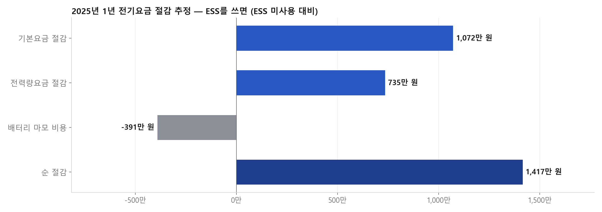
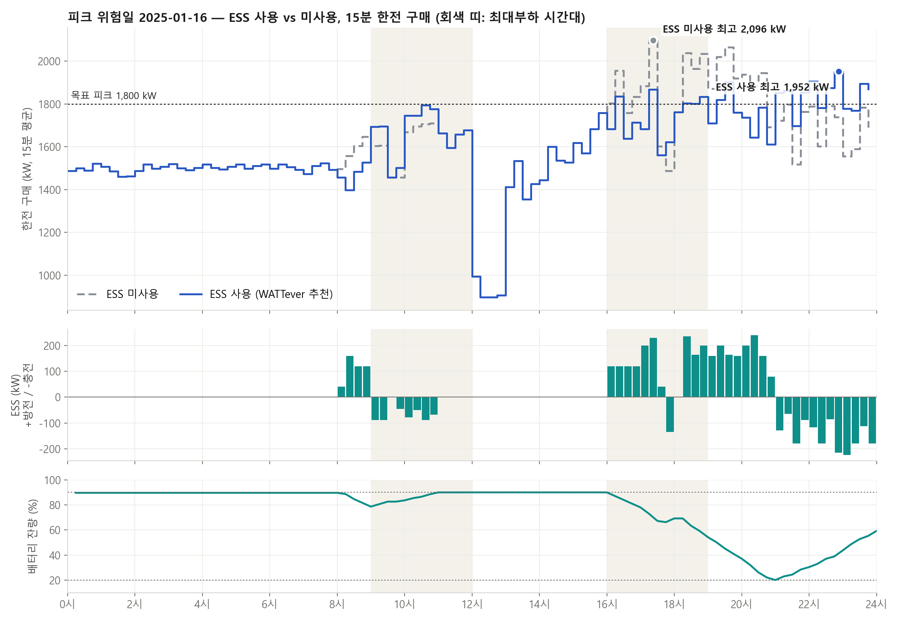
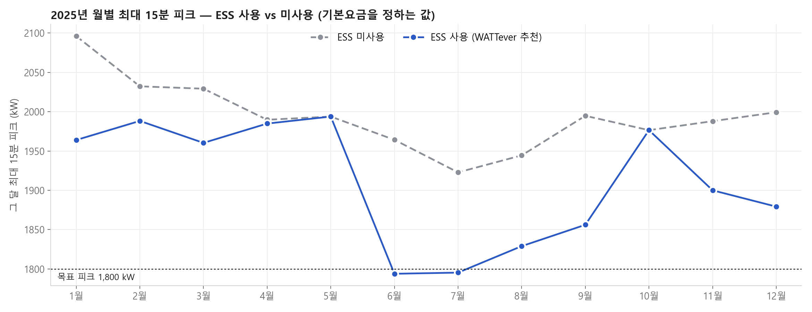

# ESS 사용 vs 미사용 — 전기요금 절감 시뮬레이션

- **질문:** WATTever로 ESS를 쓰면 안 쓸 때보다 전기요금이 얼마나 줄어드나?
- **기간:** 2025년 1년 (15분 단위 35,040칸)
- **비교**
  - **ESS 미사용:** 태양광만 쓰고 나머지는 한전에서 삼
  - **ESS 사용:** 지금 백엔드 판단 엔진의 추천을 모두 바로 적용 (자동 모드)
- 추천은 실제 백엔드 코드(`EssPlanner`)를 그대로 불러서 계산함 (2026-11-22, `dev` `408e24a` 기준)

---

## 1. 결과

| 2025년 1년              | ESS 미사용       | ESS 사용         | 차이                 |
| ----------------------- | ---------------- | ---------------- | -------------------- |
| 1년 최고 15분 피크      | 2,096 kW         | 1,994 kW         | **102 kW 낮춤**      |
| 1,800 kW 넘은 15분 구간 | 586개 (113일)    | 187개 (44일)     | 399개 줄어듦         |
| 기본요금                | 2억 928만        | 1억 9,855만      | 1,072만 절감         |
| 전력량요금              | 16억 7,895만     | 16억 7,160만     | 735만 절감           |
| **요금 합계**           | **18억 8,823만** | **18억 7,015만** | **1,808만 절감**     |
| 배터리 마모 비용        | —                | 391만            |                      |
| **순 절감**             |                  |                  | **연 약 1,417만 원** |



- ESS를 쓰면 **1년에 전기요금 약 1,808만 원**이 줄고, 배터리가 닳는 비용(391만 원)을 빼도 **약 1,417만 원**이 남음
- 절감의 큰 몫은 **기본요금**. 기본요금은 1년 중 가장 높은 15분 피크로 정해지는데, ESS가 피크를 2,096 → 1,994 kW로 낮춤
- 나머지는 **전력량요금**. 싼 시간(경부하 등)에 배터리를 채우고 비싼 시간(최대부하)에 써서 줄어듦
- 금액은 모두 **"요금 절감 추정"** (부가세 · 기금 · 설치비는 넣지 않음)

---

## 2. 피크가 가장 높은 날: 2025-01-16 (목)

ESS가 없으면 2025년 최고 피크(17:15, 2,096 kW)가 나오는 날.



- 회색 점선(ESS 미사용)은 16~21시에 1,800 kW를 여러 번 넘고 2,096 kW까지 올라감
- 파란 실선(ESS 사용)은 낮에 배터리를 90%까지 채워 두었다가 16시부터 방전해서 피크를 낮춤 → 이날 최고 1,952 kW (이 값은 밤 22:45 충전 중에 나옴 → 아래 "참고"의 개선할 점)

---

## 3. 월별 최대 피크



| 월         | 1월   | 2월   | 3월   | 4월   | 5월   | 6월   | 7월   | 8월   | 9월   | 10월  | 11월  | 12월  |
| ---------- | ----- | ----- | ----- | ----- | ----- | ----- | ----- | ----- | ----- | ----- | ----- | ----- |
| ESS 미사용 | 2,096 | 2,032 | 2,029 | 1,990 | 1,994 | 1,964 | 1,923 | 1,944 | 1,995 | 1,977 | 1,988 | 1,999 |
| ESS 사용   | 1,964 | 1,988 | 1,960 | 1,985 | 1,994 | 1,794 | 1,795 | 1,829 | 1,856 | 1,977 | 1,900 | 1,879 |

(단위 kW)

- 12개월 중 10개월은 ESS를 쓰면 그 달 최고 피크가 낮아짐 (6 · 7월은 목표 1,800 kW 아래)
- 5 · 10월은 같고 4월은 5 kW 차이로 거의 같음 → 아래 "참고"의 개선할 점

---

## 4. 어떤 데이터로 계산했나

| 값 | 데이터 |
| -- | ------ |
| 태양광 | **공용 DB의 2025년 날씨(일사량, Open-Meteo)** × 설비 1,000 kW × 성능비 0.8 ÷ 1,000 (백엔드와 같은 식) |
| 요금 | **공용 DB 요금표** (산업용(을) 고압A 선택Ⅱ) |
| ESS · 목표 설정 | **공용 DB 설정값**: 목표 피크 1,800 kW, 배터리 1,000 kWh / 500 kW, 잔량 20~90%, 효율 89.5%, 기본요금 8,320원/kW |
| 공장 부하 | 2025년 공장 부하 실측은 없어서, 팀 데이터(UCI 제철소 2018년 15분 값)를 2025년의 같은 달 · 같은 요일 날에 맞춰 씀 (공장 kW = 1,300 + 1.35 × kWh × 4) |
| 부하 예측 | 팀 AI 모델의 예측값 (AI 서버가 주는 값과 같음) |

계산 방식

- 15분마다 판단 엔진이 앞으로 24시간 계획을 다시 짜고, 지금 할 일(충전 · 방전 · 대기)을 추천 → 그대로 적용
- 기본요금: 한전 약관 제68조 (당월 포함 12개월 중 7 · 8 · 9 · 12 · 1 · 2월과 당월의 최대 피크 중 가장 큰 값 × 8,320원). 2024년 기록이 없어 2025년이 해마다 반복된다고 봄 ([기본요금 정책](../../../docs/기본요금_정책.md))
- 배터리 마모 비용: 방전 1 kWh당 20원 (판단 엔진에 들어 있는 값)
- 계획에 쓰는 태양광은 예보 대신 그날 실제 일사량을 씀 (조금 유리한 가정)

---

## 참고: 더 아낄 수 있는 부분 (백엔드 팀 공유용)

ESS 사용 결과가 4 · 5 · 10월에 미사용과 거의 같은 이유를 찾았다.

- 백엔드는 지난 1시간 동안 AI 예측이 빗나간 양을 앞으로 24시간 전체에 똑같이 더한다 (`LoadForecastService.fromAi`)
- 부하가 잠깐 튀면 하루 종일 부하가 높다고 보고, 방어선을 1,800 kW보다 올린다 (2025년 96일). 그러면 1,800을 넘어도 막지 않는다
- 이 한 단계만 빼고 다시 돌리면 1년 최고 피크 1,874 kW, 순 절감 **연 약 2,543만 원**으로 늘어난다
- 고친 뒤 아래 방법으로 다시 돌리면 바로 확인할 수 있다

---

## 다시 돌리는 법

코드는 [`code/`](code/)에 있다. 백엔드 코드는 고치지 않고 컴파일된 클래스만 쓴다. 1년 한 번에 약 30초.

| 파일 | 하는 일 |
| ---- | ------- |
| `DbQuery.java` | 공용 DB **읽기 전용** 조회 → CSV (`backend/.env`로 접속, 접속 정보는 출력하지 않음) |
| `prep_inputs_db.py` | DB 날씨 · 요금 · 설정으로 2025년 15분 입력 만들기 |
| `EssYearSim.java` | 백엔드 판단 엔진으로 1년 돌리기 |
| `analyze.py` | 요금 계산과 그래프 |

```bash
# 프로젝트 루트에서. Windows는 클래스패스 구분자가 ;  다른 OS는 :
WORK=/tmp/esssim && mkdir -p $WORK
CODE=frontend/docs/simulation/code
CP="backend/build/classes/java/main"   # 없으면 먼저: cd backend && ./gradlew compileJava
JAR="<gradle 캐시>/org.postgresql/postgresql/42.7.14/.../postgresql-42.7.14.jar"

# 1) DB에서 2025년 날씨 · 요금표 · 설정 받기 (읽기만 함)
javac -encoding UTF-8 -d $WORK $CODE/DbQuery.java
java -cp "$JAR;$WORK" DbQuery backend/.env $WORK/db_weather_2025.csv "select to_char(ts,'YYYY-MM-DD\"T\"HH24:MI:SS') ts, radiation_wm2, temperature, sky from weather where source = 'OPEN_METEO' and ts >= '2025-01-01 00:00' and ts <= '2026-01-01 01:00' order by ts"
java -cp "$JAR;$WORK" DbQuery backend/.env $WORK/db_tariff.csv "select season, period_type, to_char(start_time,'HH24:MI') s, to_char(end_time,'HH24:MI') e, unit_price from tariff_period order by season, start_time"
java -cp "$JAR;$WORK" DbQuery backend/.env $WORK/db_setting.csv "select setting_key, value from setting order by setting_key"

# 2) 입력 만들기 → 3) 1년 돌리기 → 4) 요금 계산과 그래프
python -I $CODE/prep_inputs_db.py . $WORK/db_weather_2025.csv $WORK/db_tariff.csv $WORK/db_setting.csv 2025 $WORK/inputs_2025.csv
javac -encoding UTF-8 -cp $CP -d $WORK $CODE/EssYearSim.java
java -cp "$CP;$WORK" EssYearSim $WORK/inputs_2025.csv $WORK/result_backend.csv 1800 backend
python -I $CODE/analyze.py $WORK backend 2025
```
